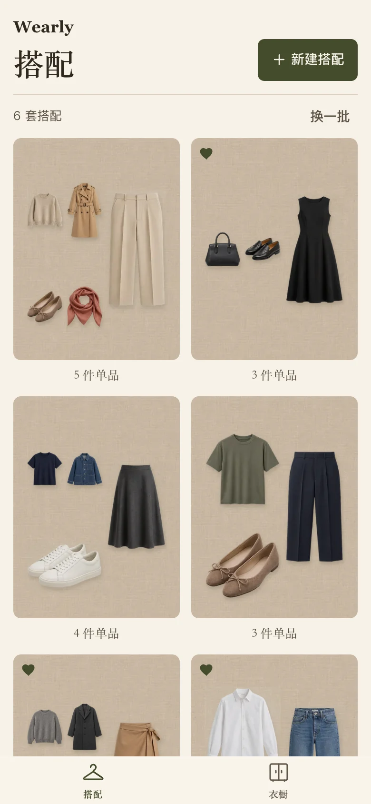

# Wearly

Wearly 是一个面向手机浏览器、可自托管的数字衣橱。拍照或从相册导入衣物，自动去除背景，再把单品组合成搭配。

## 界面预览

以下是当前 H5 在手机视口下使用演示数据的截图。

| 搭配列表                                                                           | 衣橱                                                                            | 搭配编辑                                                                                   |
| ---------------------------------------------------------------------------------- | ------------------------------------------------------------------------------- | ------------------------------------------------------------------------------------------ |
|  |  |  |

[查看完整界面与交互](design/README.md)

## 功能

- **录入单品**。拍照或选图后自动去背景，处理期间可以选择品类。保存后，衣橱里显示透明背景的单品图。
- **管理衣橱**。按品类浏览单品，修改品类、替换照片或移出衣橱。移出的单品仍可在已有搭配中查看。
- **记录搭配**。从衣橱选衣，实时预览拼图，保存后可继续编辑或收藏。
- **自托管**。部署实例使用一个共享账号和一个衣橱。SQLite 数据库与照片存放在部署主机上。

## 本地开发

使用 Node.js 24 或更高版本和 npm。以下命令从仓库根目录运行。

```sh
npm --prefix apps/api ci
npm --prefix apps/web ci
```

首次试用可运行 `npm --prefix apps/api run seed`，导入示例衣物和搭配。

在两个终端分别启动 API 和 H5。

```sh
npm --prefix apps/api run dev
```

```sh
npm --prefix apps/web run dev
```

电脑打开 [http://localhost:5173](http://localhost:5173)。手机联调时，在同一可信局域网打开 `http://电脑的局域网IP:5173`。开发代理会把同源 `/api` 请求转发到本机 API，默认端口为 `3000`。修改端口或备份演示库时，见 [API 与数据管理](apps/api/DATA.md)。

录入和换照需要抠图服务。按 [抠图服务说明](apps/cutout/README.md) 启动服务，在 `apps/api/.env.development` 设置 `WEARLY_CUTOUT_URL=http://127.0.0.1:7000/cutout`，然后重启 API。

## 自托管

使用 Docker Compose 在 Linux 服务器上部署。准备域名、持久化目录和一个共享账号。Caddy 统一为网页、API 和照片提供 HTTPS 与登录保护。首次部署见 [上线手册](deploy/README.md)，日常巡检、更新、备份和恢复见 [运维手册](deploy/OPERATIONS.md)。

## 项目结构

| 目录                           | 内容                                     |
| ------------------------------ | ---------------------------------------- |
| [`apps/web/`](apps/web/)       | uni-app、Vue 3、TypeScript 手机网页      |
| [`apps/api/`](apps/api/)       | Express、TypeScript、SQLite 与照片存储   |
| [`apps/cutout/`](apps/cutout/) | Python 3.12、FastAPI 与 rembg CPU 去背景 |
| [`deploy/`](deploy/)           | Caddy 配置、上线手册和运维手册           |

## 开发验证

```sh
npm --prefix apps/api test
npm --prefix apps/api run type-check
npm --prefix apps/web test
npm --prefix apps/web run type-check
npm --prefix apps/web run build
```

H5 构建产物位于 `apps/web/dist/build/h5/`。抠图服务可以按 [服务验证步骤](apps/cutout/README.md#启动并验证) 单独检查。

## 许可证

Wearly 自有代码采用 MIT 许可证。第三方组件和素材适用各自的许可。 [MIT 许可证](LICENSE)
