# Wearly 界面原型

这组历史原型截图展示了 Wearly 暖调服装目录的主要界面和交互状态。下载仓库后，也可在浏览器中打开 [原型预览页](prototype.html)。

## 搭配与衣橱

| 搭配列表 | 衣橱 |
| --- | --- |
| 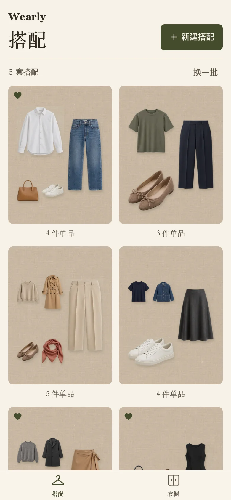 | 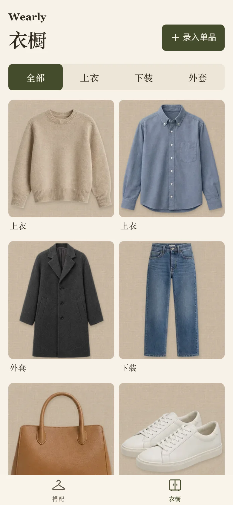 |

## 新建与编辑搭配

| 新建搭配 | 编辑搭配 | 拼图布局示例 |
| --- | --- | --- |
| 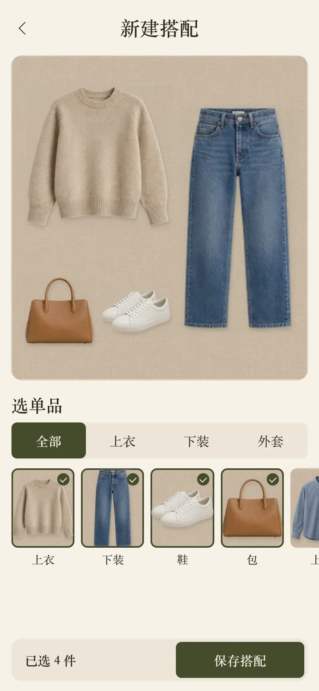 |  | 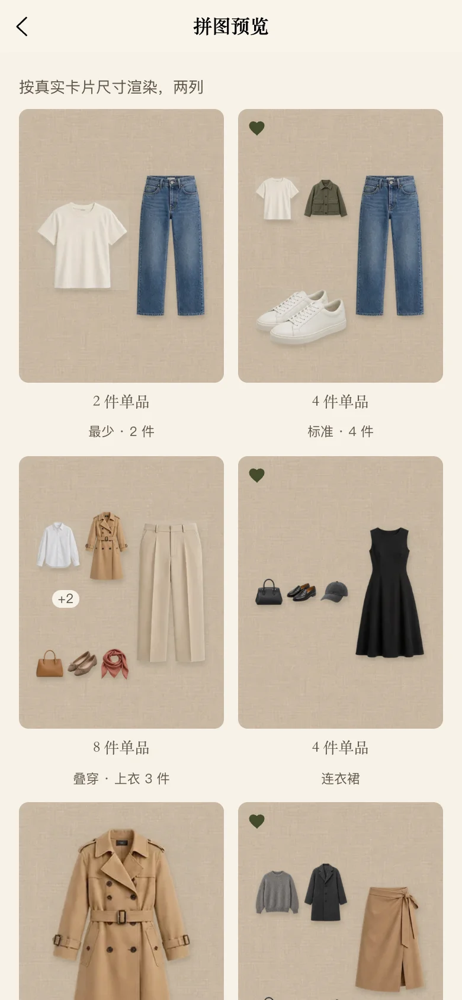 |

## 录入与单品

| 录入单品 | 单品详情 | 修改品类 |
| --- | --- | --- |
| 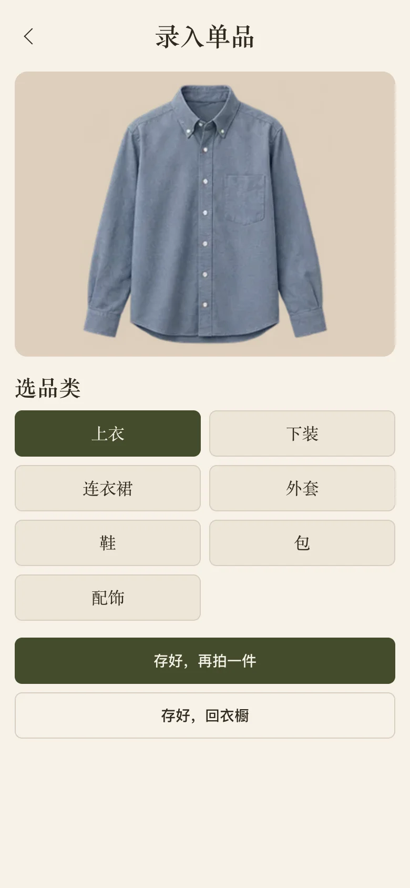 | 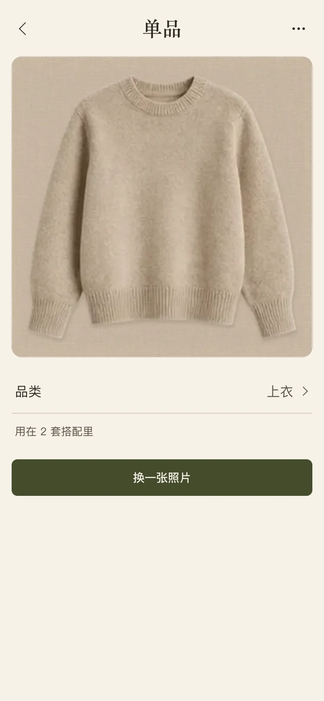 | 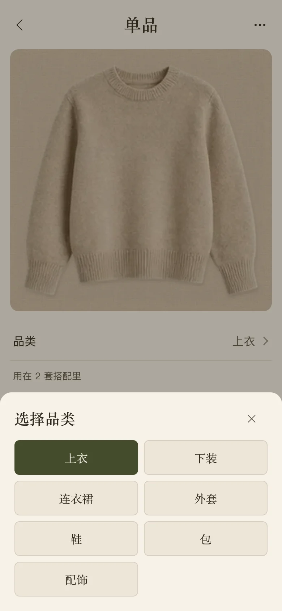 |

## 菜单与确认

| 收藏等搭配操作 | 删除搭配 | 移出衣橱 |
| --- | --- | --- |
| 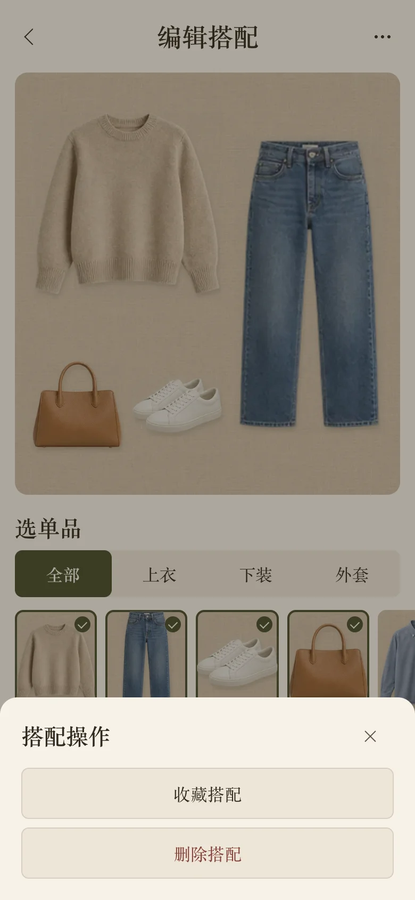 | 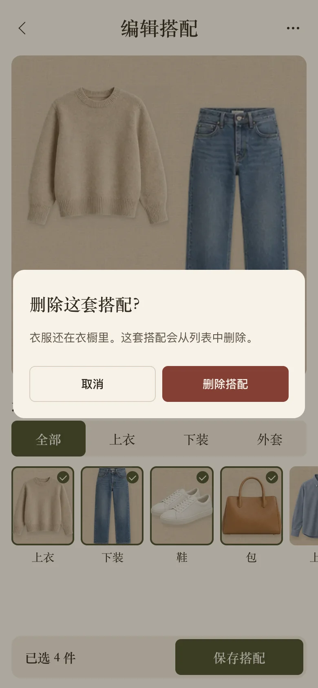 | 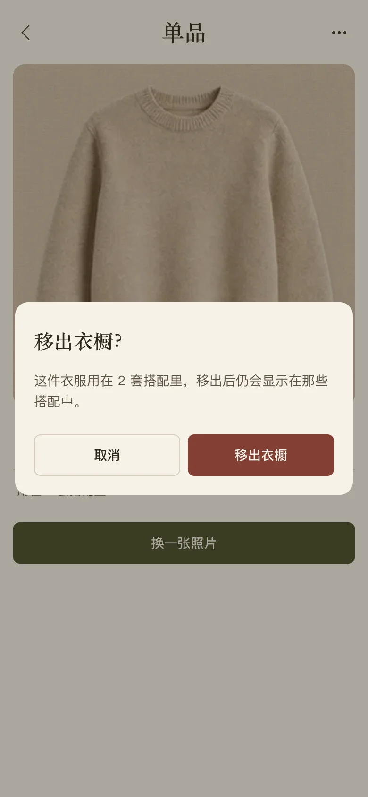 |

## 空状态

| 空衣橱 | 暂无搭配 |
| --- | --- |
| 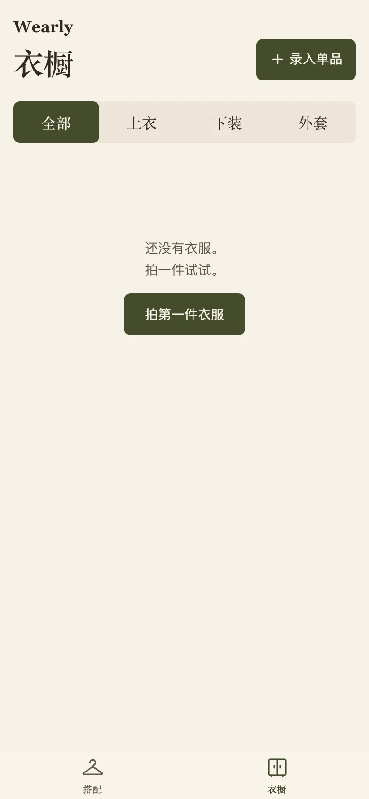 | 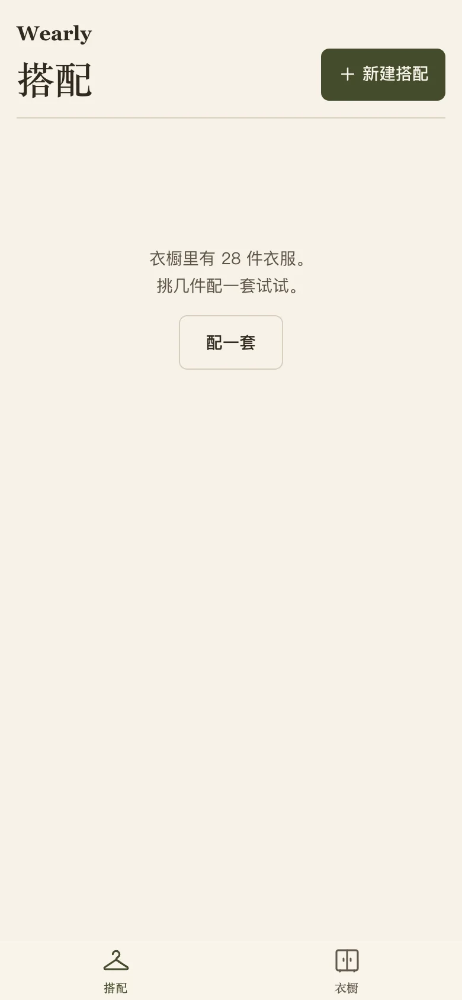 |
